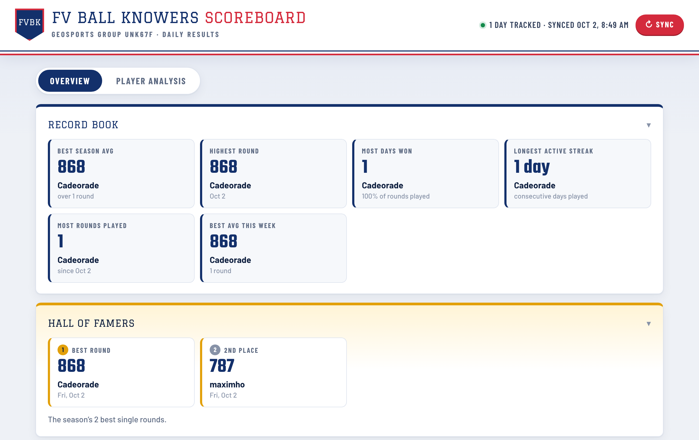
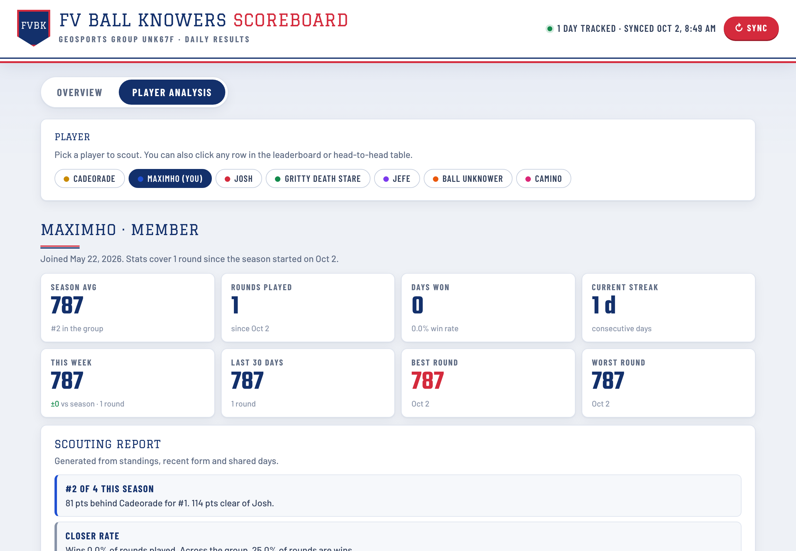
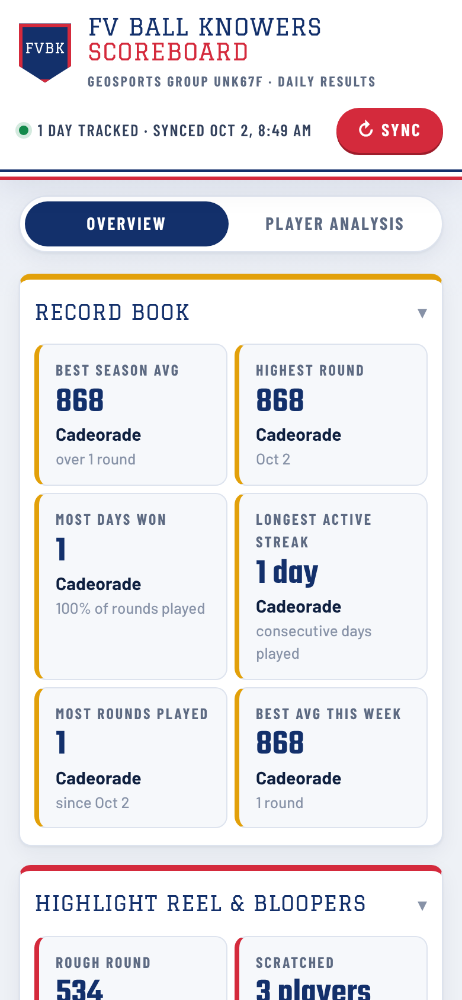

# FV Ball Knowers Scoreboard

A live scoreboard for my friends' daily [GeoSports](https://geosports.app) games. Our season starts on October 2, 2026, and every result from then on goes into a Google Sheet. This page turns the sheet into leaderboards, records, form charts and head-to-head scouting reports, all calculated from the season's scores. Update the sheet, reload the page, and the numbers change.

**▶ Live: [maximhoeft94.github.io/geosports-dashboard](https://maximhoeft94.github.io/geosports-dashboard/)**



## What it does

**Overview tab**
- Record Book (the executive summary; it, Hall of Famers and You're Benched! start collapsed): best season average, highest round, most days won, longest streak, most rounds played
- Hall of Famers and You're Benched!: the season's top 3 and bottom 3 single rounds
- Season Totals: overall leader and lowest average, group average, 7-day leader, rounds tracked, and performance rate (rounds played out of every possible player-day)
- Leaderboard for today, this week, this month and the season, ranked by average like GeoSports does, with a 7-day trend line per player
- Days-won chart and an average-score chart ranked highest first
- Space Race tab: every mile a guess has missed by, added up per player and for the group, as a race to the Moon (bars turn around and track the trip home once someone lands) and laps around the Earth, with a pixel-art astronaut orbiting the planet
- Appendix with the full daily results table (collapsed by default, click to open)

**Player Analysis tab**
- Stat cards for any player: season average, rounds, days won, win rate, streak, this week vs. the season, best and worst rounds
- Scouting report: rank gaps, recent form, win rate vs. the group, consistency, best day of the week, nemesis and favorite matchup
- Score trend with a 5-round rolling average and the group's daily average
- Head-to-head record against every other player on days both played
- Score distribution
- Average score per question: average points on each of the five daily questions (×1, ×1, ×2, ×3, ×3), strongest and weakest question, compared with everyone who has shared. Only points are stored, never the questions or answers



**Questions tab**
- Every daily question prompt since the season started, grouped by day with each question's multiplier, newest first, with a search box. Prompts only, no answers

## How it works

```
GeoSports group ──(refresh)──▶ Google Sheet ──(CSV)──▶ index.html (Chart.js)
```

- **Data:** a view-only Google Sheet with seven tabs. `Daily Scores` has one row per day and one column per player. `Players` is the group roster; anyone marked `left` in its Status column is dropped from every stat. `Info` holds the group name, the season start date and when the data was last refreshed. `Question Scores` has one row per player per question (points only, no question text or answers). `Questions` has each day's five question prompts (no answers). `Seasons` holds each finished season's final standings. `Data Sources` records where each table came from.
- **Stats:** every average, win, streak and record is calculated in the browser from `Daily Scores`, counting only days from the season start on. Weeks run Monday to Sunday, and days won are counted within each league: a day goes to the top score among that player's own league, and a tie counts as a win for each tied player. Players are split into leagues by the share of days they've played since the season started: the Major League (75%+), the Minor League (25% to 75%) and the Youth League (under 25%), recalculated on every load. A league switcher above Season Totals filters everything from there down (Season Totals, leaderboard, charts) to one league, with days won counted inside it. The Record Book, Hall of Famers and You're Benched! always cover the whole group. In the all-players view, leaderboards, the days-won chart and the average-score chart list the Major League first, then the Minor League, then the Youth League, with a divider between each (month and season also have a toggle for one overall list); Season Totals show a leader per league, and the Youth League isn't ranked by average. Today and this week rank everyone who played.
- **Seasons:** each season is a fiscal quarter, with the fiscal year one ahead of the calendar year (Oct to Dec 2026 is Q4 Season '27, Jan to Mar 2027 is Q1 Season '28). The Overview and Player Analysis cover the current season only; the Seasons tab lists every season with its league champions, most days won, best round, group average and full standings. Leagues and ranks are worked out inside each season. When a season ends, a scheduled task saves its final standings to the sheet's `Seasons` tab, and the page uses those saved rows for finished seasons so they never change.
- **Refreshing:** GeoSports shows every member's daily scores for the last 7 days. Each refresh adds new days to the sheet and updates the last 7, so late plays get picked up and older days are never overwritten. As long as a refresh happens at least once a week, no day is lost.
- **Question scores:** GeoSports only shows each player their own question-by-question results. The owner's are pulled automatically. Everyone else shares theirs with the [share page](https://maximhoeft94.github.io/geosports-dashboard/share.html): a bookmark button that reads the player's own per-question points for every day since the season started and turns them into a share code. A shared day is only imported, and only counted on the page, when its five question scores add up to that player's official daily score.
- **Page:** a single static `index.html` on GitHub Pages. It fetches each tab's CSV export straight from the browser and computes everything client-side, so there's no backend.

**Stack:** JavaScript · Chart.js · HTML/CSS · Google Sheets · GitHub Pages

## Run it locally

Open `index.html` in a browser, or serve the folder:

```bash
python3 -m http.server 8000
# open http://localhost:8000
```

To point it at a different sheet, change `SHEET_ID` in `index.html`. The sheet needs the `Daily Scores`, `Players` and `Info` tabs described above (`Info` needs a `Tracking starts` row) and must be shared as "Anyone with the link can view".

## Importing a share code

`tools/collector.js` is the readable source of the share-page button. To import a code a player sends (`GSQ1:...`):

1. Read `'Daily Scores'!A:Z` and `'Players'!A:D` from the sheet as JSON.
2. Run `python3 tools/import_share_code.py "GSQ1:..." daily_scores.json players.json`.
3. Write the returned rows to `Question Scores`, replacing any earlier rows for the same player and date. Rejected days are listed with the reason, and nothing is written for them.



---
Built by Maxim Hoeft.
